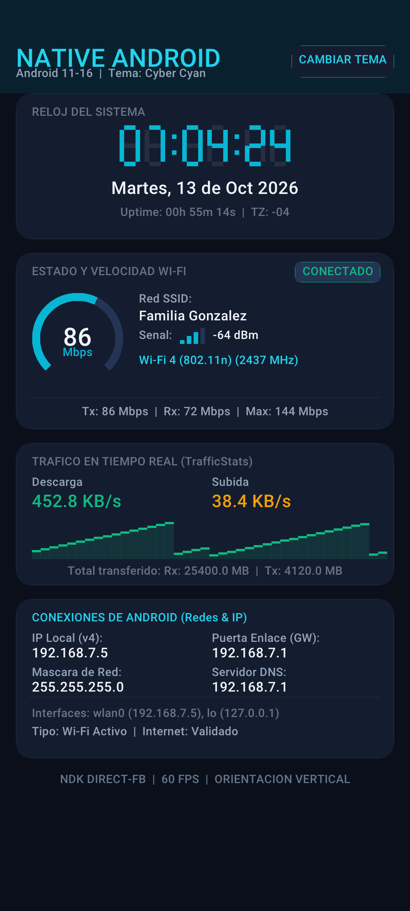

# Native C Clock & Wi-Fi Speed App (Android 11 - 16)

Aplicación Android desarrollada **100% en C puro** (sin código Java en la aplicación), diseñada específicamente para versiones de Android desde **Android 11 (API 30)** hasta **Android 16 (API 36)**.

---

## 📸 Captura de Pantalla en Dispositivo Móvil

<p align="center">
  
</p>

---

## 🚀 Características

1. **Escalado Nativo Móvil (Mobile DPI Scaling)**:
   - Diseño adaptable proporcional con unidades relativas `DP` basado en densidad de pantalla móvil (360dp baseline).
   - Proporciones, tarjetas, botones y márgenes cómodos para uso táctil con una sola mano.
   - Orientación bloqueada en vertical (*Portrait*).

2. **Renderizado de Fuentes TrueType Anti-Aliased (`stb_truetype.h`)**:
   - Integración de `stb_truetype.h` de Sean Barrett para renderizar directamente las fuentes TrueType oficiales del sistema Android (`/system/fonts/Roboto-Medium.ttf` y `Roboto-Regular.ttf`).
   - Texto nítido con suavizado de bordes (*subpixel anti-aliasing*) en títulos, subtítulos, métricas y etiquetas.

3. **Reloj Digital y Estado del Sistema en Tiempo Real**:
   - Dígitos estilizados de 7 segmentos para horas, minutos y segundos (`HH:MM:SS`).
   - Fecha completa en español (`Día, DD de Mes de AAAA`).
   - Tiempo de actividad del dispositivo (*Uptime*) obtenido mediante `sysinfo`.
   - Zona horaria activa.

4. **Monitor y Velocímetro de Wi-Fi en Vivo**:
   - Tacómetro circular animado con aguja que muestra la **rapidez del enlace Wi-Fi en Mbps** (`WifiInfo.getLinkSpeed`).
   - Velocidades de transmisión y recepción (`TxLinkSpeedMbps` y `RxLinkSpeedMbps`, API 29+).
   - Velocidad máxima soportada por el hardware (`MaxSupportedTxLinkSpeedMbps`, API 30+).
   - Medidor de intensidad de señal (barras y RSSI en dBm).
   - Identificación de estándar de red: Wi-Fi 4 (802.11n), Wi-Fi 5 (802.11ac), Wi-Fi 6/6E (802.11ax), Wi-Fi 7 (802.11be) y frecuencia en MHz (2.4 GHz vs 5 GHz).
   - Nombre de red (SSID).

5. **Tráfico de Red en Tiempo Real con Gráfico (Sparkline)**:
   - Medición por segundo de velocidad de descarga (KB/s o MB/s) y subida (KB/s o MB/s) mediante `TrafficStats`.
   - Gráfico de osciloscopio / sparkline en vivo con los últimos 40 muestreos.
   - Acumulador de datos transferidos totales (Rx / Tx).

6. **Diagnóstico Completo de Conexiones de Android (En la parte inferior)**:
   - Tipo de conexión activa: Wi-Fi / Datos Móviles / VPN / Desconectado.
   - Dirección IP Local (IPv4) de la interfaz activa.
   - Dirección IP de la Puerta de Enlace predeterminada (*Gateway*).
   - Máscara de subred (*Netmask*).
   - Servidores DNS activos (DNS1 / DNS2).
   - Lista en tiempo real de interfaces de red del kernel (`wlan0`, `rmnet`, `lo`, etc.) mediante `getifaddrs()`.
   - Verificación de conectividad a Internet.

7. **Ícono Personalizado de Aplicación**:
   - Ícono personalizado integrado en todas las densidades mipmap (`mdpi`, `hdpi`, `xhdpi`, `xxhdpi`, `xxxhdpi`) y versión redondeada `ic_launcher_round`.

8. **4 Temas Neón con Animación de Ondas**:
   - **Cyber Cyan** (Neón cian / estilo futurista)
   - **Emerald Matrix** (Verde matriz)
   - **Solar Amber** (Ámbar cálido)
   - **Sunset Purple** (Púrpura neón)
   - Toca cualquier parte de la pantalla o el botón de tema para alternar.

---

## 🛠️ Estructura del Proyecto

```
native/
├── .github/
│   └── workflows/
│       └── build.yml               # Workflow de GitHub Actions para compilar el APK
├── app/
│   ├── build.gradle.kts            # Configuración Gradle con compileSdk 36, minSdk 30
│   └── src/
│       └── main/
│           ├── AndroidManifest.xml # Manifiesto con NativeActivity, permisos e icono
│           ├── cpp/
│           │   ├── CMakeLists.txt  # Configuración CMake para NDK
│           │   ├── main.c          # Ciclo de vida NativeActivity e hilo de render
│           │   ├── ui_renderer.c   # Motor gráfico móvil responsive en C
│           │   ├── ui_renderer.h
│           │   ├── tt_font.c       # Renderizador de fuentes TrueType con stb_truetype
│           │   ├── tt_font.h
│           │   ├── stb_truetype.h  # Biblioteca de fuentes TrueType (Sean Barrett)
│           │   ├── wifi_stats.c    # Diagnóstico de Wi-Fi, DHCP y getifaddrs
│           │   ├── wifi_stats.h
│           │   ├── font8x16.c      # Matriz de fuente bitmap de respaldo
│           │   └── font8x16.h
│           └── res/
│               ├── values/
│               │   └── strings.xml
│               ├── mipmap-mdpi/     # Iconos de launcher generados
│               ├── mipmap-hdpi/
│               ├── mipmap-xhdpi/
│               ├── mipmap-xxhdpi/
│               └── mipmap-xxxhdpi/
├── build.gradle.kts
├── settings.gradle.kts
├── build_local.sh                  # Script de compilación, empaquetado y firma
├── mobile_rendered.png             # Vista previa del renderizado móvil
└── README.md
```

---

## ⚙️ Compilación Automática en GitHub Actions

El repositorio incluye el archivo `.github/workflows/build.yml`. Cada vez que hagas `git push` a `main`:
1. GitHub Actions configurará el entorno Ubuntu con Java 17, Gradle, Android SDK Platform 36 y NDK.
2. Compilará automáticamente el proyecto usando Gradle y CMake.
3. Generará el artefacto descargable: `NativeC-Clock-WiFi-APK` (APK firmado y listo para instalar).

---

## 📱 Compilación y Prueba Local

Para compilar y empaquetar directamente con Termux o Linux:
```bash
./build_local.sh
```
El APK firmado resultante se genera en `app-debug.apk`.
